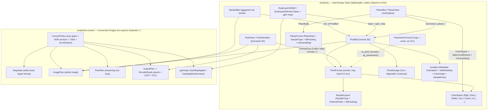
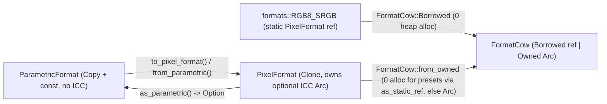
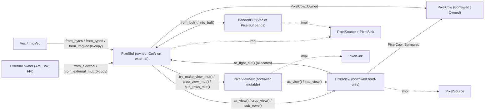
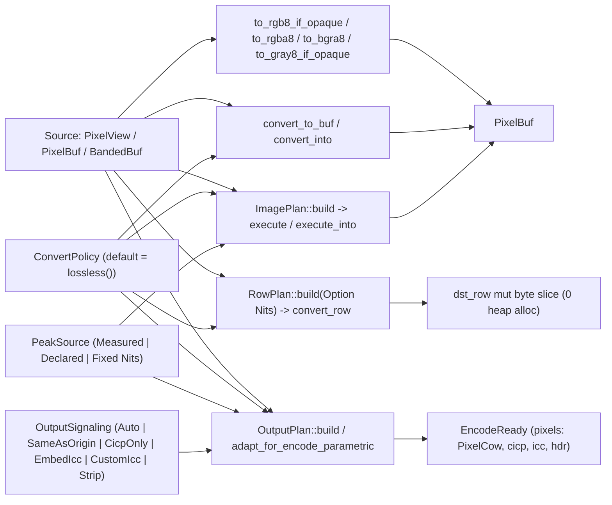

# `zenpixels` 0.5 Type Atlas & Visual Drilldown

Start with a **struct or enum name** below to see how it fits into the `zenpixels` / `zenpixels-convert` type hierarchy, what fields and variants it contains, the most common real-world values, and how to construct and use it.

- Looking for task-oriented recipes? See [docs/guide.md](guide.md).
- Upgrading from 0.2 or 0.4? See [docs/migration-0.2-to-0.5.md](migration-0.2-to-0.5.md).

---

## Quick Type Index (Start by Name)

### 1. Format & Color Description (`zenpixels`)

| Type | Kind | One-line role | Jump to |
|---|---|---|---|
| `PixelFormat` | `struct` | Full pixel description: `layout: SampleLayout` + `color: ColorSpace` (can own ICC `Arc<[u8]>`) | [Drilldown 1](#drilldown-1-pixelformat-parametricformat-formatcow-samplelayout-colorspace) |
| `ParametricFormat` | `struct` (`Copy`) | Drop-free, `const` `SampleLayout` + `ParametricColor` (no ICC) for static codec capability tables | [Drilldown 1](#pixelformat-vs-parametricformat-vs-formatcow-vs-formats) |
| `FormatCow<'a>` | `enum` | Zero-alloc `Borrowed(&'a PixelFormat)` or `Owned(Arc<PixelFormat>)` stored inside views | [Drilldown 1](#pixelformat-vs-parametricformat-vs-formatcow-vs-formats) |
| `SampleLayout` | `struct` (`Copy`) | Physical byte shape: `sample: SampleType`, `order: ChannelOrder`, `packing: BitPacking` | [Drilldown 1](#anatomy-of-pixelformat) |
| `SampleType` | `enum` (`Copy`) | Scalar element storage: `U8`, `U16`, `U32`, `U64`, `I8`..`I64`, `F16`, `F32`, `F64` | [Drilldown 1](#anatomy-of-pixelformat) |
| `ChannelOrder` | `enum` (`Copy`) | Interleaved channel sequence: `Rgb`, `Rgba`, `Bgr`, `Bgra`, `Rgbx`, `Bgrx`, `Gray`, `GrayAlpha`, `Cmyk*`, `Oklab*`, `Xyz*`, `Perceptual*`, `Generic(u8)` | [Drilldown 1](#anatomy-of-pixelformat) |
| `BitPacking` | `enum` (`Copy`) | Coded bit placement inside storage words: `Full`, `Lsb { bits }`, `Msb { bits }`, `Shifted`, `Bitfields` (`U10_LSB`, `P010`, `RGB565`, `RGB10A2`) | [Drilldown 1](#anatomy-of-pixelformat) |
| `ColorSpace` | `enum` | Algebraic color interpretation: `Rgb`, `Gray`, `Oklab`, `Xyz`, `Perceptual`, `Cmyk`, `Icc`, `Untagged` | [Drilldown 1](#anatomy-of-pixelformat) |
| `ParametricColor` | `enum` (`Copy`) | `Copy` mirror of `ColorSpace` excluding `Icc` and `Cmyk.icc` | [Drilldown 1](#pixelformat-vs-parametricformat-vs-formatcow-vs-formats) |
| `Primaries` / `CustomPrimaries` | `enum` / `struct` | RGB chromaticity primaries (`Bt709`, `DisplayP3`, `Bt2020`, `AdobeRgb`, `DciP3`, `Custom(...)`, etc.) | [Drilldown 1](#anatomy-of-pixelformat) |
| `Transfer` / `Gamma` / `HlgMode` | `enum` / `struct` / `enum` | Electro-optical curve: `Srgb`, `Linear`, `Pq`, `Hlg(Scene \| Display(HlgRendering))`, `Bt709`, `Gamma22`, `Gamma(Gamma)`, etc. | [Drilldown 1](#anatomy-of-pixelformat) |
| `AlphaMode` | `enum` (`Copy`) | Alpha channel meaning: `None`, `Opaque`, `Straight`, `Premultiplied`, `Undefined` | [Drilldown 1](#anatomy-of-pixelformat) |
| `SignalRange` | `enum` (`Copy`) | Integer code swing: `Full` (`0..=255` / `0..=65535`) vs `Narrow` (studio `16..=235`) | [Drilldown 1](#anatomy-of-pixelformat) |
| `RenderingIntent` | `enum` (`Copy`) | ICC rendering intent: `Perceptual`, `RelativeColorimetric`, `Saturation`, `AbsoluteColorimetric` | [Drilldown 1](#anatomy-of-pixelformat) |
| `WhitePoint` / `Chromaticity` | `enum` / `struct` | CIE 1931 `(x, y)` chromaticity (`D65`, `D50`, `Dci`, `C`, `E`, `Custom(...)`) | [Drilldown 1](#anatomy-of-pixelformat) |

### 2. Packed Image Carriers & Storage (`zenpixels`)

| Type | Kind | One-line role | Jump to |
|---|---|---|---|
| `PixelBuf` | `struct` | Owned, alignment-exact, stride-preserving 2D image buffer + metadata (`Orientation`, `HdrMetadata`, `ColorOrigin`, `SampleFacts`) | [Drilldown 2](#drilldown-2-packed-image-carriers-pixelbuf-pixelview-pixelviewmut-pixelstorage-bandedbuf) |
| `PixelView<'a>` | `struct` | Zero-copy borrowed strided 2D image or rectangular crop (immutable) | [Drilldown 2](#drilldown-2-packed-image-carriers-pixelbuf-pixelview-pixelviewmut-pixelstorage-bandedbuf) |
| `PixelViewMut<'a>` | `struct` | Zero-copy borrowed mutable strided 2D image or rectangular crop | [Drilldown 2](#drilldown-2-packed-image-carriers-pixelbuf-pixelview-pixelviewmut-pixelstorage-bandedbuf) |
| `PixelRect` | `struct` (`Copy`) | Rectangular crop region `{ x, y, width, height }` in pixels passed to every `crop*` / `into_crop` method | [Drilldown 2](#constructing-borrowing-cropping--relabeling) |
| `PixelCow<'a>` | `enum` | `Borrowed(PixelView<'a>)` or `Owned(PixelBuf)` (used by `EncodeReady`) | [Drilldown 2](#ownership-and-borrowing-relationships) |
| `PixelStorage` | `enum` | Owned backing memory behind `PixelBuf`/`PlaneBuf` (`U8`..`F64`, `F16`, `Aligned64`, `External`, `ExternalMut`) | [Drilldown 2](#anatomy-of-pixelbuf-and-pixelstorage) |
| `PixelBufParts` | `struct` | All 10 fields of `PixelBuf` disassembled for `into_parts` / `from_parts` | [Drilldown 2](#anatomy-of-pixelbuf-and-pixelstorage) |
| `BandedBuf` / `BandSizing` / `BandRowLocation` | `struct` / `enum` | Gigapixel-safe image split into bounded-memory horizontal `Vec<PixelBuf>` bands (`BandSizing::{MaxBandBytes, RowsPerBand}`, `locate_row -> Option<BandRowLocation>`) | [Drilldown 2](#bandedbuf-for-gigapixel-images) |
| `InPlaceTransformInput` / `Output` | `struct` | Named input/output structs for `PixelBuf::transform_in_place` closure | [Drilldown 2](#anatomy-of-pixelbuf-and-pixelstorage) |
| `PixelSource` / `PixelSink` | `trait` | Row-by-row source/sink traits implemented by `PixelBuf`, `PixelView`/`PixelViewMut`, and `BandedBuf` | [Drilldown 2](#ownership-and-borrowing-relationships) |
| `ByteStorage` / `ByteStorageMut` | `trait` | Zero-copy external backing storage traits (`Arc<[T]>`, `Box<[T]>`, `Vec<T>`, custom FFI owners) | [Drilldown 2](#anatomy-of-pixelbuf-and-pixelstorage) |
| `RowAlign` / `BufFill` / `InteropTarget` | `enum` | Stride alignment (`Tight`, `Cache64`, `PixelCache64`, `Samples(u16)`), initial fill (`Black`, `White`), and interop preflight | [Drilldown 2](#choosing-a-pixelbuf-constructor) |
| `F16Sample`, `Rgbx`, `Bgrx`, `GrayAlpha*` | `struct` | Built-in `#[repr(C)]` `Pod` sample and pixel element types | [Drilldown 2](#choosing-a-pixelbuf-constructor) |

### 3. Planar & Bit-Packed Carriers (`zenpixels`)

| Type | Kind | One-line role | Jump to |
|---|---|---|---|
| `PlanarBuf` | `struct` | Owned multi-plane image (`Vec<PlaneBuf>`, e.g. YCbCr 4:2:0, P010, planar RGB+A) + frame-level color/matrix/siting | [Drilldown 3](#drilldown-3-planar-and-bit-packed-types) |
| `PlanarView<'a>` / `PlanarViewMut<'a>` | `struct` | Borrowed multi-plane image or chroma-phase-exact crop (inline for `<= 4` planes, zero alloc) | [Drilldown 3](#drilldown-3-planar-and-bit-packed-types) |
| `PlaneBuf` / `PlaneView<'a>` / `PlaneViewMut<'a>` | `struct` | Single plane (owned or borrowed) pairing `PlaneFormat` + `(width, height, stride_bytes)` + storage/bytes | [Drilldown 3](#anatomy-of-planarbuf-and-planeformat) |
| `PlaneFormat` | `struct` (`Copy`) | Per-plane descriptor: `role: PlaneRole`, `sample: SampleType`, `components: u8`, `packing: BitPacking`, `subsampling: (u8, u8)` | [Drilldown 3](#anatomy-of-planarbuf-and-planeformat) |
| `PlaneRole` | `enum` (`Copy`) | Semantic role: `Y`, `Cb`, `Cr`, `CbCr`, `CrCb`, `R`, `G`, `B`, `Alpha`, `Cyan`, `Magenta`, `Yellow`, `Key`, `Depth`, `GainMap`, `Matte`, `Thermal`, `Packed`, `Extra(u16)` | [Drilldown 3](#anatomy-of-planarbuf-and-planeformat) |
| `SampleStride` | `struct` (`Copy`) | Newtype `SampleStride(usize)` expressing a plane stride in scalar elements `S` (not bytes) | [Drilldown 3](#plane-stride-rules-bytes-vs-samples) |
| `CodePlane<'a>` / `CodePlaneMut<'a>` / `InterleavedCodeLayout` | `struct` | Zero-copy reader/writer for raw N-bit integer codes (`0..=1023`, etc.) and interleaved component layout | [Drilldown 3](#codeplane-and-sampleencoding) |
| `SampleEncoding` | `struct` (`Copy`) | Integer word bit-layout for `CodePlane` / `CodeMap`: `(storage: SampleType, code_bits: u8, bit_shift: u8)` | [Drilldown 3](#codeplane-and-sampleencoding) |
| `ChromaSiting` | `enum` (`Copy`) | Subsampled chroma sample position relative to luma (`Unknown`, `Center`, `Left`, `TopLeft`, `Top`, `BottomLeft`, `Bottom`) | [Drilldown 3](#anatomy-of-planarbuf-and-planeformat) |
| `ChromaSubsampling` | `enum` (`Copy`) | Chroma grid ratio: `Mono`, `Yuv444`, `Yuv422`, `Yuv420`, `Yuv440`, `Yuv411` | [Drilldown 3](#anatomy-of-planarbuf-and-planeformat) |
| `MatrixCoefficients` | `struct` (`Copy`) | Lossless 1-byte H.273 Table 4 matrix code (`BT709`, `BT601`, `BT2020_NCL`, `IDENTITY`, `YCGCO`, `ICTCP`, `from_code(u8)`) | [Drilldown 3](#anatomy-of-planarbuf-and-planeformat) |

### 4. Metadata, Evidence, Orientation & Dual-Layer HDR (`zenpixels`)

| Type | Kind | One-line role | Jump to |
|---|---|---|---|
| `ColorOrigin` / `OriginKind` | `struct` / `enum` | File provenance of original color chunks (`Assumed`, `Cicp`, `Icc`, `IccAndCicp`, `GamaChrm`), distinct from active `ColorSpace` | [Drilldown 4](#colororigin-cicp-and-cicptag) |
| `Cicp` / `CicpTag` | `struct` (`Copy`) | 4-byte H.273 CICP tuple and 12/44-byte ICC.1 `cicpType` tag (with signed `s15Fixed16` custom primaries) | [Drilldown 4](#colororigin-cicp-and-cicptag) |
| `HdrMetadata` | `struct` (`Copy`) | Optional `content_light_level: Option<ContentLightLevel>` + `mastering: Option<MasteringDisplay>` | [Drilldown 4](#hdrmetadata-nits-diffusewhite-and-hlgrendering) |
| `Nits` / `DiffuseWhite` / `HlgRendering` | `struct` (`Copy`) | Validated positive luminance units (cd/m²), SDR paper-white anchor (`BT2408` = 203 nits), and HLG display OOTF | [Drilldown 4](#hdrmetadata-nits-diffusewhite-and-hlgrendering) |
| `SampleFacts` / `ExactDepth` / `FloatFacts` | `struct` (`Copy`) | Proven or caller-asserted content invariants (`all_opaque`, `all_grayscale`, `binary_alpha`, exact bit-grid depth, float finiteness/range) | [Drilldown 4](#samplefacts-exactdepth-and-floatfacts) |
| `Orientation` | `enum` (`Copy`) | EXIF 1..=8 D4 dihedral transform (`Identity`, `FlipH`, `Rotate90`, `Rotate180`, `Rotate270`, `FlipV`, `Transpose`, `Transverse`) | [Drilldown 4](#orientation) |
| `DualLayerHdrBuf` / `DualLayerHdrView<'a>` | `struct` | ISO 21496-1 / UltraHDR base layer + gain map layer + `GainMapMetadata` + optional alternate `ColorSpace` | [Drilldown 4](#duallayerhdrbuf-and-gainmapmetadata) |
| `GainMapMetadata` / `GainMapChannels` / `GainMapComponent` | `struct` / `enum` / `struct` | Rational ISO 21496-1 gain-map math parameters (`SignedFraction` / `UnsignedFraction` with `.numerator`/`.denominator`) | [Drilldown 4](#duallayerhdrbuf-and-gainmapmetadata) |

### 5. Conversion Engine (`zenpixels-convert`)

| Type | Kind | One-line role | Jump to |
|---|---|---|---|
| `ConvertPolicy` | `struct` | Complete conversion rules: loss gates (`DepthPolicy`, `AlphaPolicy`, `GamutPolicy`, `RangePolicy`), luma, HDR anchors, CMS, tone mapper, SIMD | [Drilldown 5](#drilldown-5-conversion-engine-zenpixels-convert) |
| `ImagePlan` | `struct` | Compiled reusable whole-image converter (`PixelSource` → `PixelBuf` or `PixelSink`) | [Drilldown 5](#choosing-a-conversion-entry-point) |
| `RowPlan` | `struct` | Compiled streaming row-by-row converter with zero per-row heap allocation (`convert_row` / `convert_row_at`) | [Drilldown 5](#choosing-a-conversion-entry-point) |
| `OutputPlan` / `EncodeReady<'a>` / `OutputSignaling` / `ResolvedSignaling` | `struct` / `struct` / `enum` / `struct` | Encoder adaptation plan that converts pixels and resolves matching CICP + ICC signaling atomically | [Drilldown 5](#outputplan-negotiate-and-encodeready) |
| `Negotiate` / `NegotiatedFormat` / `FormatCost` / `LossKind` | `struct` / `struct` / `struct` / `enum` | Picks the lowest-loss, lowest-effort encoder format from `&[PixelFormat]` or `&[ParametricFormat]` | [Drilldown 5](#outputplan-negotiate-and-encodeready) |
| `Accelerators` | `struct` (`Copy`) | `const` SIMD accelerator table (`SCALAR`, `LAYOUT`, `WEB_SDR`, `HDR`, `GAINMAP`, `OKLAB`, `ROW_PIPELINE`, `ALL`) | [Drilldown 5](#convertpolicy-anatomy-and-presets) |
| `CmsBackend` / `CmsTransform` / `MoxCms` / `Lcms` | `trait` / `struct` | Pluggable ICC/CMYK color management backends (`cms-moxcms`, `cms-lcms` features) | [Drilldown 5](#convertpolicy-anatomy-and-presets) |
| `ToneMapper` / `Bt2446A` / `Bt2446APipelineManaged` / `SoftCompress` | `trait` / `struct` | Pluggable HDR→SDR tone mapper (ITU-R BT.2446 Method A: baked `Bt2446A` or `Bt2446APipelineManaged`) and Oklab gamut soft-knee compressor | [Drilldown 5](#convertpolicy-anatomy-and-presets) |
| `GainMapApplier` / `GainMapLayer` / `GainMapApplyConfig` / `GainMapExtractConfig` / `GainMapRowExtractor` | `struct` | Streaming and whole-image ISO 21496-1 / UltraHDR gain-map rendering and extraction (`gainmap` module) | [Drilldown 5](#gain-maps-compaction-and-measurement) |
| `PlanarReconstructionOptions` / `ChromaUpsample` | `struct` / `enum` | Planar YCbCr/GBR/RGB → interleaved reconstruction settings (`nearest`, `bilinear`, siting fallback) | [Drilldown 3](#constructing-and-reconstructing-planar-images) |
| `CompactionReport` / `AlphaCompaction` | `struct` / `enum` | Content analysis (`requires_alpha`, `requires_chroma`, `requires_u16_precision`) + lossless compaction | [Drilldown 5](#gain-maps-compaction-and-measurement) |
| `LightLevelHistogram` / `LightLevelMethod` | `struct` / `enum` | HDR luminance histogram for `MaxCLL` / `MaxFALL` / peak measurement | [Drilldown 5](#gain-maps-compaction-and-measurement) |
| `CodeMap` / `CodeRole` | `struct` / `enum` | Bit-depth and bit-shift integer code remapping between `SampleEncoding`s | [Drilldown 3](#codeplane-and-sampleencoding) |

---

## Big-Picture Architecture Map

Every packed image in `zenpixels` separates **bytes in memory** (`PixelStorage` / `&[u8]`) from **what those bytes mean** (`PixelFormat`), **where the file came from** (`ColorOrigin`), **display geometry** (`Orientation`), **HDR luminance bounds** (`HdrMetadata`), and **proven content facts** (`SampleFacts`).



---

## Drilldown 1: `PixelFormat`, `ParametricFormat`, `FormatCow`, `SampleLayout`, `ColorSpace`

### Anatomy of `PixelFormat`

```text
PixelFormat (Clone, Eq, Hash — NOT Copy because ColorSpace::Icc holds Arc<[u8]>)
├── layout: SampleLayout (Copy, const)
│   ├── sample:  SampleType      ── U8 | U16 | U32 | U64 | I8..I64 | F16 | F32 | F64
│   ├── order:   ChannelOrder    ── Rgb | Rgba | Bgr | Bgra | Rgbx | Bgrx | Gray | GrayAlpha
│   │                               | Cmyk | CmykInverted | Cmyka | CmykaInverted
│   │                               | Oklab | OklabA | Xyz | XyzA | Perceptual3 | Perceptual4
│   │                               | Generic(u8)
│   └── packing: BitPacking      ── Full | Lsb { bits } | Msb { bits } | Shifted { bits, shift }
│                                   | Bitfields { bits: [u8; 4], shifts: [u8; 4] }
│                                   (const presets: U10_LSB, U12_LSB, P010, RGB565, RGB10A2)
│
└── color: ColorSpace (Clone, Eq, Hash)
    ├── Rgb        { primaries: Primaries, transfer: Transfer, range: SignalRange,
    │                alpha: AlphaMode, white: Option<DiffuseWhite> }
    ├── Gray       { transfer: Transfer, range: SignalRange,
    │                alpha: AlphaMode, white: Option<DiffuseWhite> }
    ├── Oklab      { alpha: AlphaMode }
    ├── Xyz        { white_point: WhitePoint, alpha: AlphaMode, white: Option<DiffuseWhite> }
    ├── Perceptual { space: PerceptualSpace (CieLab | CieLch | Oklch | Hsl | Hsv | Jzazbz | Jzczhz),
    │                alpha: AlphaMode }
    ├── Cmyk       { inverted: bool, alpha: AlphaMode, icc: Option<Arc<[u8]>> }
    ├── Icc        { profile: Arc<[u8]>, color_channels: u8, alpha: AlphaMode, intent: RenderingIntent }
    └── Untagged   { total_channels: u8, alpha: AlphaMode }

    where:
    ├── Primaries  ── Bt709 | DisplayP3 | Bt2020 | AdobeRgb | DciP3 | Bt601 | Bt470M | Bt470Bg
    │                 | Smpte240M | GenericFilm | Xyz | Ebu3213 | Custom(CustomPrimaries) | Unknown
    ├── Transfer   ── Srgb | Linear | Pq | Hlg(HlgMode::Scene | HlgMode::Display(HlgRendering))
    │                 | Bt709 | Bt601 | Bt2020_10bit | Bt2020_12bit | Gamma22 | Gamma28
    │                 | AdobeRgb | DciCinema | Gamma(Gamma) | ... | Unknown
    ├── AlphaMode  ── None | Opaque | Straight | Premultiplied | Undefined
    └── SignalRange── Full (0..=255 / 0..=65535) | Narrow (studio 16..=235 / 4096..=60160)
```

### `PixelFormat` vs `ParametricFormat` vs `FormatCow` vs `formats::*`

Why are there four related spellings? Because `ColorSpace::Icc` holds an `Arc<[u8]>`, which gives `PixelFormat` non-trivial `Drop`:



| Use this | When |
|---|---|
| `PixelFormat::RGB8_SRGB` (owned `const`) | Constructing `PixelBuf` or chaining `.with_alpha(...)` / `.with_primaries(...)` |
| `&formats::RGB8_SRGB` (`&'static PixelFormat`) | Borrowing into `PixelView::from_bytes` / `PixelView::new` or passing endpoints to `convert_to_buf` / `ImagePlan::build` / `RowPlan::build` with **zero heap allocation** |
| `ParametricFormat::RGB8_SRGB` (`Copy + const`) | `const SUPPORTED: &[ParametricFormat] = &[...];` codec capability tables passed to `Negotiate::select_parametric` / `adapt_for_encode_parametric` |
| `FormatCow<'a>` | Escape hatch for `PixelView::new_with_format_cow` when a view must hold a dynamically built custom/ICC `PixelFormat` |

### Most-Used `PixelFormat` Examples

| Real-world image | Preset or construction | `layout` | `color` |
|---|---|---|---|
| Web JPEG / PNG RGB8 | `PixelFormat::RGB8_SRGB` / `&formats::RGB8_SRGB` | `U8` · `Rgb` · `Full` | `Rgb { Bt709, Srgb, Full, None, None }` |
| Straight-alpha PNG / WebP | `PixelFormat::RGBA8_SRGB` / `&formats::RGBA8_SRGB` | `U8` · `Rgba` · `Full` | `Rgb { Bt709, Srgb, Full, Straight, None }` |
| Premultiplied RGBA8 (compositing/GPU) | `PixelFormat::RGBA8_SRGB.with_alpha(AlphaMode::Premultiplied)` | `U8` · `Rgba` · `Full` | `Rgb { Bt709, Srgb, Full, Premultiplied, None }` |
| Opaque 4-channel RGBA8 (fast 32-bit pixels) | `PixelFormat::RGBA8_SRGB.with_alpha(AlphaMode::Opaque)` | `U8` · `Rgba` · `Full` | `Rgb { Bt709, Srgb, Full, Opaque, None }` |
| RGBX / BGRX with ignored padding byte | `PixelFormat::BGRX8_SRGB` | `U8` · `Bgrx` · `Full` | `Rgb { Bt709, Srgb, Full, Undefined, None }` |
| Display P3 16-bit sRGB | `PixelFormat::RGB16_SRGB.with_primaries(Primaries::DisplayP3)` | `U16` · `Rgb` · `Full` | `Rgb { DisplayP3, Srgb, Full, None, None }` |
| Linear working-space float | `PixelFormat::RGBAF32_LINEAR` / `&formats::RGBAF32_LINEAR` | `F32` · `Rgba` · `Full` | `Rgb { Bt709, Linear, Full, Straight, None }` |
| HDR10 / BT.2100 PQ 16-bit | `PixelFormat::RGB16_BT2100_PQ` | `U16` · `Rgb` · `Full` | `Rgb { Bt2020, Pq, Full, None, None }` |
| HDR BT.2100 HLG (scene vs 1000-nit display) | `PixelFormat::RGB16_BT2100_HLG_SCENE` / `RGB16_BT2100_HLG_1000` | `U16` · `Rgb` · `Full` | `Rgb { Bt2020, Hlg(Scene \| Display(1000 nit)), ... }` |
| Arbitrary ICC profile (e.g. Adobe RGB) | `PixelFormat::new(SampleLayout::RGB8, ColorSpace::Icc { profile, color_channels: 3, alpha: AlphaMode::None, intent: RenderingIntent::RelativeColorimetric })` | `U8` · `Rgb` · `Full` | `Icc { profile: Arc<[u8]>, ... }` |
| CMYK JPEG (with optional ICC) | `PixelFormat::cmyk8(Some(icc_arc))` or `PixelFormat::cmyk8(None)` | `U8` · `Cmyk` · `Full` | `Cmyk { inverted: false, None, icc }` |
| Grayscale 8-bit / linear float | `PixelFormat::GRAY8_SRGB` / `PixelFormat::GRAYF32_LINEAR` | `U8`/`F32` · `Gray` · `Full` | `Gray { Srgb / Linear, Full, None, None }` |

### Constructing & Validating `PixelFormat`

```rust
use std::sync::Arc;
use zenpixels::{
    AlphaMode, BitPacking, ChannelOrder, ColorSpace, DiffuseWhite, ParametricFormat,
    PixelFormat, Primaries, RenderingIntent, SampleLayout, SampleType, SignalRange, Transfer,
    formats,
};

// 1. Owned const preset + builder tweaks (unchecked until validate() or buffer/plan creation):
let p3_premul = PixelFormat::RGBA8_SRGB
    .with_primaries(Primaries::DisplayP3)
    .with_alpha(AlphaMode::Premultiplied);
p3_premul.validate()?;

// 2. Checked builder (returns Option<PixelFormat>; None if variant doesn't carry primaries):
assert!(PixelFormat::GRAY8_SRGB.try_with_primaries(Primaries::DisplayP3).is_none());

// 3. Explicit custom layout + ColorSpace (e.g. 10-bit narrow-range BT.2020 PQ):
let pq10_narrow = PixelFormat::new(
    SampleLayout::new(SampleType::U16, ChannelOrder::Rgb).with_packing(BitPacking::U10_LSB),
    ColorSpace::BT2100_PQ.with_range(SignalRange::Narrow).with_white(DiffuseWhite::BT2408),
);
pq10_narrow.validate()?;

// 4. Static capability table (Copy + const) <-> PixelFormat:
const ENCODER_FORMATS: &[ParametricFormat] = &[
    ParametricFormat::RGB8_SRGB,
    ParametricFormat::RGBA8_SRGB,
    ParametricFormat::GRAY8_SRGB,
];
let owned: PixelFormat = ENCODER_FORMATS[0].to_pixel_format();
assert_eq!(owned.as_parametric(), Some(ParametricFormat::RGB8_SRGB));

// 5. Static borrowed reference (zero allocation for PixelView / plans):
let static_ref: &'static PixelFormat = &formats::RGB8_SRGB;
assert_eq!(&owned, static_ref);

// 6. ICC-tagged RGB8:
let icc_fmt = PixelFormat::new(
    SampleLayout::RGB8,
    ColorSpace::Icc {
        profile: Arc::from(icc_bytes),
        color_channels: 3,
        alpha: AlphaMode::None,
        intent: RenderingIntent::RelativeColorimetric,
    },
);
assert!(icc_fmt.as_parametric().is_none()); // ICC cannot project to Copy ParametricFormat
```

---

## Drilldown 2: Packed Image Carriers (`PixelBuf`, `PixelView`, `PixelViewMut`, `PixelStorage`, `BandedBuf`)

### Ownership and Borrowing Relationships



### Anatomy of `PixelBuf` and `PixelStorage`

Every `PixelBuf` can be disassembled losslessly into `PixelBufParts` (and reassembled with `PixelBuf::from_parts` / `from_parts_recover`):

```text
PixelBuf  <── into_parts() / from_parts() ──>  PixelBufParts
├── storage:     PixelStorage
│   ├── U8(Vec<u8>) | U16(Vec<u16>) | U32(Vec<u32>) | U64(Vec<u64>)
│   ├── I8(Vec<i8>) | I16(Vec<i16>) | I32(Vec<i32>) | I64(Vec<i64>)
│   ├── F16(Vec<F16Sample>) | F32(Vec<f32>) | F64(Vec<f64>)
│   ├── Aligned64(AlignedSamples)           // 64-byte cache-line aligned allocation
│   ├── External(ExternalStorage)           // Read-only zero-copy (Arc<[u8]>, FFI); CoW on mutation
│   └── ExternalMut(ExternalMutStorage)     // Mutable zero-copy (Box<[T]>, custom ByteStorageMut)
├── byte_offset:  usize                      // Byte offset into storage (updated O(1) by into_crop!)
├── width:        u32                        // Active width in pixels
├── height:       u32                        // Active height in rows
├── stride_bytes: usize                      // Byte distance between consecutive row starts (>= width * bpp)
├── format:       PixelFormat                // layout: SampleLayout + color: ColorSpace
├── facts:        SampleFacts                // Proven/asserted content facts (cleared on mutable access)
├── hdr:          HdrMetadata                // Optional ContentLightLevel + MasteringDisplay
├── origin:       ColorOrigin                // Original file signaling provenance
└── orientation:  Orientation                // EXIF 1..=8 (Identity by default)

PixelView<'a>                               PixelViewMut<'a>
├── data:         &'a [u8]                  ├── data:         &'a mut [u8]
├── width:        u32                       ├── width:        u32
├── height:       u32                       ├── height:       u32
├── stride_bytes: usize                     ├── stride_bytes: usize
├── format:       FormatCow<'a>             ├── format:       FormatCow<'a>
├── facts:        SampleFacts               ├── hdr:          HdrMetadata
├── hdr:          HdrMetadata               └── orientation:  Orientation
├── origin:       Option<&'a ColorOrigin>
└── orientation:  Orientation
```

### Choosing a `PixelBuf` Constructor

| If you have… | Use | Notes |
|---|---|---|
| Nothing yet — want safe black pixels | `PixelBuf::new(w, h, format)` | Fills black; fills alpha to channel max if `AlphaMode::Opaque` |
| Nothing yet — want reference white | `PixelBuf::new_white(w, h, format)` | `255`/`65535`/`1.0` (studio `235 << shift` for narrow range) |
| Nothing yet — decoder will overwrite every byte | `PixelBuf::new_raw_zeroed(w, h, format)` | Fastest (zero-fill only); **refuses `AlphaMode::Opaque`** on alpha-bearing layouts |
| Custom row alignment (e.g. 64-byte SIMD) | `PixelBuf::new_aligned(w, h, format, RowAlign::Cache64)` or `new_raw_zeroed_aligned` / `new_with_fill` | `RowAlign::{Tight, Cache64, PixelCache64, Samples(u16)}` |
| Tight `Vec<u8>` raw bytes | `PixelBuf::from_bytes(bytes, w, h, format)` | Use `from_bytes_recover` to get `Vec<u8>` back on error |
| Tight `Vec<P>` (`u8`, `u16`, `f32`, `[u8; 3]`, `Rgbx`, `rgb::Rgb<u8>`) | `PixelBuf::from_typed(vec, w, h, format)` | Checks `P: TypedElement` against `format.layout`; use `from_typed_recover` to recover |
| Tight scalar `Vec<S>` (`u8`/`u16`/`f32`/`F16Sample`) | `PixelBuf::from_samples(vec, w, h, format)` | Checks `S::SAMPLE_TYPE == format.layout.sample` |
| Tight `rgb::Rgb<T>` / `Rgba<T>` (`rgb` feature) | `PixelBuf::from_pixels_with_color(vec, w, h, ColorSpace::SRGB)` | Layout inferred from `P::LAYOUT`, so takes `ColorSpace` (not `PixelFormat`) |
| Arbitrary `Vec<P: Pod>` (unchecked cast) | `PixelBuf::from_pod_bytes_unchecked(vec, w, h, format)` | Reinterprets native-endian bytes without checking `P`'s channel structure |
| External `Arc<[u8]>`, `Box<[T]>`, or FFI buffer | `PixelBuf::from_external(owner, w, h, stride_bytes, format)` / `from_external_mut` | Zero-copy; returns `Err((err, owner))` on failure; `_with_byte_offset` takes a leading byte offset |

### Constructing, Borrowing, Cropping & Relabeling

```rust
use std::sync::Arc;
use zenpixels::{AlphaMode, ColorSpace, PixelBuf, PixelFormat, PixelRect, PixelView, formats};

// 1. Borrow raw bytes with zero heap allocation using `&formats::*`:
let raw = [255u8, 0, 0, 0, 255, 0, 0, 0, 255, 255, 255, 255];
let view = PixelView::from_bytes(&raw, 2, 2, &formats::RGB8_SRGB)?;
assert_eq!(view.row(1), &[0, 0, 255, 255, 255, 255]);

// 2. Adopt shared Arc<[u8]> zero-copy, crop in O(1), mutate via fallible CoW:
let shared: Arc<[u8]> = Arc::from(raw.to_vec());
let mut buf = PixelBuf::from_external(shared.clone(), 2, 2, 6, PixelFormat::RGB8_SRGB)
    .map_err(|(err, _orig)| err)?;
let crop = buf.crop_view(PixelRect::new(1, 0, 1, 2))?;
assert_eq!(crop.stride_bytes(), 6);        // Parent stride preserved; row(y) has 3 active bytes
buf.try_make_view_mut()?.row_mut(0)[0] = 42; // CoW promotes `buf`; `shared` stays untouched

// 3. Relabel metadata without changing pixel bytes:
let p3_buf = buf.relabel_color(ColorSpace::DISPLAY_P3)?; // Same layout, new ColorSpace
let bgr_buf = p3_buf.relabel_format(PixelFormat::BGR8_SRGB)?; // Same sample/bpp, different order
let _tight = bgr_buf.into_crop(PixelRect::new(0, 0, 1, 2))?.into_tight_rows()?; // O(1) crop, then pack tight rows
```

### `BandedBuf` for Gigapixel Images

`BandedBuf` holds `Vec<PixelBuf>` horizontal bands sized via `BandSizing::{MaxBandBytes(usize), RowsPerBand(u32)}` (default `BandSizing::DEFAULT`), and implements both `PixelSource` and `PixelSink` so `ImagePlan::execute` / `execute_into` and `apply_orientation_banded` process arbitrarily large images without one contiguous allocation:

```rust
use zenpixels::{BandRowLocation, BandSizing, BandedBuf, PixelFormat};

let mut big = BandedBuf::new(4096, 4096, PixelFormat::RGB8_SRGB, BandSizing::DEFAULT)?;
let BandRowLocation { band_index, local_y } = big.locate_row(1000).unwrap();
let _row: &[u8] = big.row(1000);
let _band_view = big.band_view(band_index).unwrap();
```

---

## Drilldown 3: Planar and Bit-Packed Types

### Anatomy of `PlanarBuf` and `PlaneFormat`

```text
PlanarBuf (owned) / PlanarView<'a> (inline <= 4 planes, 0-alloc) / PlanarViewMut<'a>
├── width, height:       u32                      // Full luma-frame dimensions in pixels
├── crop_origin:         (u32, u32)               // Luma-grid crop origin (views; preserves chroma phase)
├── color:               Option<ColorSpace>       // Primaries + transfer (+ optional range/alpha)
├── matrix_coefficients: Option<MatrixCoefficients> // 1-byte H.273 Table 4 code (BT709, BT601, BT2020_NCL, ...)
├── chroma_siting:       ChromaSiting             // Unknown | Center | Left | TopLeft | Top | BottomLeft | Bottom
├── range_override:      Option<SignalRange>      // Overrides color.range() -> read via effective_range()
├── alpha_override:      Option<AlphaMode>        // Overrides color.alpha() -> read via effective_alpha()
├── hdr:                 HdrMetadata
├── origin:              ColorOrigin (Option<&'a ColorOrigin> on PlanarView)
├── orientation:         Orientation
└── planes:              [PlaneBuf | PlaneView<'a> | PlaneViewMut<'a>] (1..=MAX_PLANES)
    ├── format: PlaneFormat (Copy, const)
    │   ├── role:        PlaneRole                // Y | Cb | Cr | CbCr | CrCb | R | G | B | Alpha | ...
    │   ├── sample:      SampleType               // U8 | U16 | F32 | ...
    │   ├── components:  u8                       // 1 for Y/Cb/Cr/R/G/B/Alpha; 2 for CbCr/CrCb
    │   ├── packing:     BitPacking               // Full | U10_LSB | U12_LSB | P010 | ...
    │   └── subsampling: (u8, u8)                 // (hx, vy): (1,1)=4:4:4, (2,1)=4:2:2, (2,2)=4:2:0
    ├── width, height:   u32                      // THIS plane's element dimensions (post-subsampling!)
    ├── stride_bytes:    usize                    // Row stride in BYTES
    └── storage / data:  PixelStorage / &'a [u8] / &'a mut [u8]
```

### Most-Used Planar Examples

| Format | Planes (`PlaneFormat`) | Frame metadata |
|---|---|---|
| 8-bit 4:2:0 YCbCr (JPEG / AV1 I420) | `Y (U8, 1×1)`, `Cb (U8, 2×2)`, `Cr (U8, 2×2)` | `ColorSpace::SRGB`, `MatrixCoefficients::BT601` (JPEG) or `BT709` (AV1), `ChromaSiting::Center` or `Left` |
| 10-bit 4:2:0 LSB (AV1 / HEVC) | `Y (U16, U10_LSB, 1×1)`, `Cb (U16, U10_LSB, 2×2)`, `Cr (U16, U10_LSB, 2×2)` | `ColorSpace::BT2100_PQ`, `MatrixCoefficients::BT2020_NCL`, `SignalRange::Narrow`, `ChromaSiting::TopLeft` |
| P010 semi-planar (hardware video) | `Y (U16, P010, 1×1)`, `CbCr (U16, components=2, P010, 2×2)` | `ColorSpace::BT2100_PQ`, `MatrixCoefficients::BT2020_NCL`, `SignalRange::Narrow` |
| Planar F32 RGB + Alpha (EXR / JXL) | `R (F32)`, `G (F32)`, `B (F32)`, `Alpha (F32)` | `ColorSpace::LINEAR_SRGB_ALPHA` |

### Plane Stride Rules (Bytes vs Samples)

| Constructor on `PlaneView` / `PlaneViewMut` / `PlaneBuf` | Args | Stride unit |
|---|---|---|
| `from_samples(samples, width, height, plane_format)` | 4 args | Tight automatic (`width * components * size_of::<S>()`) |
| `from_samples_strided(samples, width, height, SampleStride(n), plane_format)` | 5 args | **Scalar elements `S`** (wrapped in `SampleStride` so bytes cannot be confused with samples) |
| `new(bytes, width, height, stride_bytes, plane_format)` | 5 args | **Bytes** (`stride_bytes()` always returns bytes) |

### Constructing and Reconstructing Planar Images

```rust
use zenpixels_convert::{
    BitPacking, ChromaSiting, ColorSpace, MatrixCoefficients, PixelBuf, PixelFormat,
    PlanarReconstructionOptions, PlanarView, PlaneFormat, PlaneRole, PlaneView, SampleLayout,
    SampleStride, SampleType, SignalRange, reconstruct_planar_into, reconstruct_planar_to_buf,
};

let y_fmt = PlaneFormat::new(PlaneRole::Y, SampleType::U16).with_packing(BitPacking::U10_LSB);
let cb_fmt = PlaneFormat::new(PlaneRole::Cb, SampleType::U16)
    .with_packing(BitPacking::U10_LSB)
    .with_subsampling(2, 2);
let cr_fmt = PlaneFormat::new(PlaneRole::Cr, SampleType::U16)
    .with_packing(BitPacking::U10_LSB)
    .with_subsampling(2, 2);

// Tight typed samples (or `from_samples_strided(..., SampleStride(padded_samples), fmt)`):
let py = PlaneView::from_samples(&y_u16, 4, 4, y_fmt)?;
let pcb = PlaneView::from_samples(&cb_u16, 2, 2, cb_fmt)?;
let pcr = PlaneView::from_samples(&cr_u16, 2, 2, cr_fmt)?;

let planar = PlanarView::new(4, 4, &[py, pcb, pcr])?
    .with_color(ColorSpace::SRGB)
    .with_matrix_coefficients(MatrixCoefficients::BT709)
    .with_range_override(SignalRange::Narrow)
    .with_chroma_siting(ChromaSiting::Left);

// Option A: allocate interleaved RGBA8 buffer:
let rgba = reconstruct_planar_to_buf(
    &planar,
    SampleLayout::RGBA8,
    &PlanarReconstructionOptions::bilinear(),
)?;

// Option B: zero-alloc into pre-allocated destination (src, dst, options):
let mut dst = PixelBuf::new(4, 4, PixelFormat::BGRA8_SRGB)?;
reconstruct_planar_into(
    &planar,
    &mut dst.as_view_mut(),
    &PlanarReconstructionOptions::bilinear(),
)?;
```

### `CodePlane` and `SampleEncoding`

When you want raw integer codes (e.g. 10-bit `0..=1023` from `U10_LSB` or `P010`) without color math:

```rust
use zenpixels_convert::{
    CodeMap, CodeRole, SampleEncoding, SampleType, SignalRange, unpack_code_planes_into,
};

// Borrow component 0 directly from a PlaneView:
let code_plane = py.as_code_plane(0)?;
let sample_code: Option<u16> = code_plane.code(0, 0);

// Map individual N-bit codes between encodings (e.g. 10-bit LSB -> 16-bit full):
let enc10 = SampleEncoding::new(SampleType::U16, 10, 0)?;
let enc16 = SampleEncoding::new(SampleType::U16, 16, 0)?;
let map = CodeMap::new(enc10, enc16, CodeRole::Intensity, SignalRange::Full)?;
let widened_code = map.map_code(512);
```

---

## Drilldown 4: Metadata, Evidence, Orientation & Dual-Layer HDR

### `ColorOrigin`, `Cicp`, and `CicpTag`

```text
ColorOrigin (file provenance — what the container originally declared)
├── kind: OriginKind ── Assumed | Cicp | Icc | IccAndCicp | GamaChrm
├── cicp: Option<Cicp>
│   ├── color_primaries:          u8   (H.273 Table 2: 1=BT.709, 9=BT.2020, 12=Display P3)
│   ├── transfer_characteristics: u8   (H.273 Table 3: 1=BT.709, 8=Linear, 13=sRGB, 16=PQ, 18=HLG)
│   ├── matrix_coefficients:      u8   (H.273 Table 4: 0=Identity/RGB, 1=BT.709, 6=BT.601, 9=BT.2020)
│   └── full_range:               bool
└── icc:  Option<Arc<[u8]>>            (raw ICC profile bytes)

CicpTag (ICC.1 cicpType: 12-byte base OR 44-byte extended with signed s15Fixed16 CustomPrimaries)
```

`ColorSpace` on `PixelFormat` says **what the pixels mean right now**; `ColorOrigin` says **what the input file originally contained** so `OutputSignaling::SameAsOrigin` / `Auto` knows whether to preserve or re-emit CICP/ICC.

```rust
use zenpixels::{AlphaMode, Cicp, CicpTag, ColorOrigin, CustomPrimaries};

let cicp = Cicp::DISPLAY_P3;
let color = cicp.to_color_space(AlphaMode::None)?;
let origin = ColorOrigin::from_cicp(cicp);

// 44-byte ICC.1 cicpType with custom primaries (supports negative chromaticities like ACES AP0):
let tag = CicpTag::with_custom_primaries(CustomPrimaries::ACES_AP0, 16, 0, true);
assert_eq!(tag.encoded_len(), 44);
```

### `HdrMetadata`, `Nits`, `DiffuseWhite`, and `HlgRendering`

```text
HdrMetadata (Copy, Default = empty)
├── content_light_level: Option<ContentLightLevel>
│   ├── max_content_light_level:       u16   (MaxCLL in cd/m²)
│   └── max_frame_average_light_level: u16   (MaxFALL in cd/m²)
└── mastering: Option<MasteringDisplay>      (presets: HDR10_REFERENCE, DISPLAY_P3_1000)
    ├── primaries_xy:   [[f32; 2]; 3]        (R, G, B CIE xy)
    ├── white_point_xy: [f32; 2]             (white CIE xy)
    ├── max_luminance:  f32                  (cd/m²)
    └── min_luminance:  f32                  (cd/m²)

Validated luminance wrappers:
├── Nits(f32)         ── finite > 0.0; Nits::new_positive(1000.0) -> Option<Nits>, const Nits::new_positive_or_panic(1000.0)
├── DiffuseWhite(f32) ── SDR paper-white anchor; DiffuseWhite::new(v) -> Option, DiffuseWhite::BT2408 = 203.0 nits
└── HlgRendering      ── peak: Nits, black_nits: f32, system_gamma: f32 (REFERENCE_1000_NIT; HlgRendering::new(HlgRenderingParams { ... }))
```

### `SampleFacts`, `ExactDepth`, and `FloatFacts`

```text
SampleFacts (Copy, Default = NONE; automatically cleared on any mutable pixel access!)
├── float:         FloatFacts         (bitflags: NO_NAN, NO_INFINITE, NO_SUBNORMALS,
│                                      NON_NEGATIVE, POSITIVE, AT_MOST_ONE, FINITE,
│                                      UNIT_INTERVAL, NORMAL_UNIT_INTERVAL)
├── depth:         Option<ExactDepth> (storage: SampleType, range: SignalRange,
│                                      color_bits: u8, alpha_bits: u8)
├── all_opaque:    bool               (every active alpha sample == channel max)
├── all_grayscale: bool               (every active pixel has R == G == B)
└── binary_alpha:  bool               (every active alpha sample is 0 or max)
```

- **Measured / seeded facts:** `scan_facts(&view)`, `buf.into_opaque_verified()`, or freshly filled `PixelBuf::new` / `new_white`.
- **Caller-asserted facts:** `buf.assume_facts(facts)`, `view.with_assumed_facts(facts)`, `policy.with_source_facts(facts)`.
- **Builder:** `SampleFacts::NONE.with_all_opaque(true).with_depth(exact_depth)` (`with_depth` accepts either `ExactDepth` or `Option<ExactDepth>`).

### `Orientation`

`Orientation` is the 8-element EXIF dihedral group (`Identity = 1`, `FlipH = 2`, `Rotate180 = 3`, `FlipV = 4`, `Transpose = 5`, `Rotate90 = 6`, `Transverse = 7`, `Rotate270 = 8`).

- **Metadata-only (O(1), zero pixel movement):** `buf.with_orientation(o)`, `buf.set_orientation(o)`, `buf.compose_orientation(delta)` (composes `old.then(delta)`), `buf.display_dimensions()`.
- **Physical pixel movement (`zenpixels-convert`):** `bake_orientation_owned(buf)` (bakes pending metadata into pixels and resets orientation to `Identity`; zero-copy if already `Identity`) or `apply_orientation(&view, o)` (applies an explicit transform).

### `DualLayerHdrBuf` and `GainMapMetadata`

```text
DualLayerHdrBuf / DualLayerHdrView<'a>
├── base:                  PixelBuf / PixelView<'a>   (SDR or HDR base rendition)
├── gain_map:              PixelBuf / PixelView<'a>   (1-channel Gray or 3-channel RGB gain map)
├── metadata:              GainMapMetadata (Copy)
│   ├── channels:               GainMapChannels::Shared(GainMapComponent)
│   │                         | GainMapChannels::PerChannel([GainMapComponent; 3])
│   │                           └── GainMapComponent:
│   │                               ├── min_gain_stops:   SignedFraction   { numerator: i32, denominator: NonZeroU32 }
│   │                               ├── max_gain_stops:   SignedFraction
│   │                               ├── gamma:            UnsignedFraction { numerator: u32, denominator: NonZeroU32 }
│   │                               ├── base_offset:      SignedFraction
│   │                               └── alternate_offset: SignedFraction
│   ├── base_hdr_headroom:      UnsignedFraction (log2 stops)
│   ├── alternate_hdr_headroom: UnsignedFraction (log2 stops)
│   ├── application_space:      GainMapColorSpace::Base | Alternate
│   └── backward_direction:     Option<bool>
├── alternate_color_space: Option<ColorSpace>         (required when application_space == Alternate)
└── orientation:           Orientation                (shared by both base and gain map)
```

---

## Drilldown 5: Conversion Engine (`zenpixels-convert`)

### Dataflow Across Entry Points



### `ConvertPolicy` Anatomy and Presets

```text
ConvertPolicy (Default == ConvertPolicy::lossless() — refuses silent loss!)
├── Loss Permission Gates
│   ├── depth:              DepthPolicy      ── Forbid | Round | OrderedDither | Truncate
│   ├── alpha:              AlphaPolicy      ── Forbid | DiscardIfOpaque | DiscardUnchecked | CompositeOnto(Color)
│   ├── gamut:              GamutPolicy      ── Forbid | PreserveExtended | Clip | SoftCompress
│   └── range:              RangePolicy      ── Forbid | Convert
├── RGB -> Gray Luma
│   ├── luma:               LumaCoefficients ── FromSourcePrimaries | Bt709 | Bt601 | Bt2020 | Custom([f32; 3])
│   └── luma_domain:        LumaDomain       ── Encoded (JPEG/video Y') | LinearLight (physical Y)
├── HDR Anchors & Tone Mapping
│   ├── sdr_white:          Option<DiffuseWhite>
│   ├── sdr_peak:           Nits
│   ├── hlg_rendering:      Option<HlgRendering>
│   ├── tone_map_hdr_to_sdr: bool
│   └── tone_mapper:        Option<Arc<dyn ToneMapper>>  (e.g. Bt2446A::pipeline_managed())
└── Backends, Evidence & SIMD
    ├── cms:                    Option<Arc<dyn CmsBackend>> (e.g. MoxCms, Lcms)
    ├── allow_icc_substitution: bool
    ├── allow_approximate:      bool
    ├── source_facts:           SampleFacts
    └── accelerators:           Option<Accelerators> (None -> global process setting; default scalar)
```

| Preset | `depth` | `alpha` | `gamut` | `range` | `tone_map_hdr_to_sdr` | `allow_icc_substitution` |
|---|---|---|---|---|---|---|
| `ConvertPolicy::lossless()` (`default()`) | `Forbid` | `Forbid` | `PreserveExtended` | `Forbid` | `false` | `false` |
| `ConvertPolicy::permissive()` | `Round` | `DiscardUnchecked` | `Clip` | `Convert` | `false` | `true` |
| `ConvertPolicy::working_linear()` | `Round` | `DiscardIfOpaque` | `PreserveExtended` | `Convert` | `false` (`BT2408` white) | `true` |
| `ConvertPolicy::display_sdr(white, peak)` | `Round` | `CompositeOnto(BLACK)` | `Clip` | `Convert` | `true` | `true` |

### Choosing a Conversion Entry Point

```rust
use std::sync::Arc;
use zenpixels_convert::{
    Accelerators, Bt2446A, ConvertPolicy, DiffuseWhite, ImagePlan, Nits, PeakSource, PixelBuf,
    PixelFormat, RowPlan, convert_to_buf, formats, to_rgba8,
};

// 1. One-line 8-bit sRGB:
let rgba = to_rgba8(&src_view)?;

// 2. One-shot arbitrary destination (lossless widening RGB8 -> linear F32):
let linear = convert_to_buf(&src_view, &formats::RGBF32_LINEAR, &ConvertPolicy::lossless())?;

// 3. Streaming row loop (zero per-row heap allocation):
let row_plan = RowPlan::build(
    &formats::RGB8_SRGB,
    &formats::RGBF32_LINEAR,
    &ConvertPolicy::lossless().with_accelerators(Accelerators::WEB_SDR),
    None, // resolved source peak (Only needed for HDR -> SDR tone mapping)
)?;
let mut dst = PixelBuf::new(src_view.width(), src_view.height(), PixelFormat::RGBF32_LINEAR)?;
for y in 0..src_view.height() {
    row_plan.convert_row_at(y, src_view.row(y), dst.row_mut(y), src_view.width())?;
}

// 4. Whole-image HDR PQ -> SDR tone mapping with streaming peak measurement:
let hdr_policy = ConvertPolicy::display_sdr(DiffuseWhite::BT2408, Nits::new_positive(100.0).unwrap())
    .with_tone_mapper(Arc::new(Bt2446A::pipeline_managed()));
let sdr = ImagePlan::build(
    &formats::RGB16_BT2100_PQ,
    &formats::RGB8_SRGB,
    &hdr_policy,
    PeakSource::Measured,
)?
.execute(&pq_view)?;
```

### `OutputPlan`, `Negotiate`, and `EncodeReady`

Encoders combine format selection (`Negotiate`) with pixel conversion and container metadata signaling (`OutputSignaling`) in one step:

```rust
use zenpixels_convert::{
    ConvertPolicy, OutputSignaling, ParametricFormat, PeakSource, adapt_for_encode_parametric,
};

const SUPPORTED: &[ParametricFormat] = &[
    ParametricFormat::RGB8_SRGB,
    ParametricFormat::RGBA8_SRGB,
    ParametricFormat::GRAY8_SRGB,
];

let (negotiated, ready) = adapt_for_encode_parametric(
    buf.as_view(),
    buf.origin(),
    SUPPORTED,
    &ConvertPolicy::permissive(),
    PeakSource::Measured,
    OutputSignaling::Auto,
)?;
// `negotiated.format` is the chosen PixelFormat (`negotiated.index`, `negotiated.loss`, `negotiated.cost`)
// `ready.pixels` is `PixelCow::Borrowed` if already compatible (zero copy!), or `PixelCow::Owned`
// `ready.cicp` and `ready.icc` match `ready.pixels` atomically
```

### Gain Maps, Compaction, and Measurement

- **Gain maps (`zenpixels_convert::gainmap`):** Configure application via `GainMapApplyConfig::from_headroom_stops(stops)` or `from_display_boost_linear(boost)` (plus `.with_destination_format(...)`, `.with_orientation(...)`, `.with_resample(...)`), then run `apply_gain_map_with(&dual_view, &cfg, &Unstoppable)` or streaming `GainMapApplier::for_view(&dual_view, &cfg)` (or `GainMapApplier::new(GainMapLayer::new(...), GainMapLayer::new(...), ...)`). Extract via `GainMapExtractConfig::default()` / `::ultrahdr()` + `extract_gain_map_only`.
- **Compaction (`zenpixels_convert::compact`):** `analyze_compaction(&view)` returns `CompactionReport { requires_alpha, requires_chroma, requires_u16_precision }`, `.candidate_format(src_format)` computes the smallest lossless target, and `compact_to_buf` / `compact_in_place` perform the reduction.
- **HDR Measurement (`zenpixels_convert::measure`):** `measure_content_light_level`, `measure_peak`, `measure_histogram` → `LightLevelHistogram` (note: `quantile_nits(quantile)` and `to_robust_content_light_level(quantile)` expect a fraction `0.0..=1.0`, e.g. `0.9999`).

---

## Key Contracts & Conventions to Keep in Mind

| Area | Contract |
|---|---|
| `PixelBuf::new` vs `PixelBuf::new_raw_zeroed` | `new` fills black + channel-max alpha for `AlphaMode::Opaque`. `new_raw_zeroed` skips alpha fill and **rejects `AlphaMode::Opaque`** with `BufferError::UnverifiedOpaqueAlpha` until you fill pixels and call `into_opaque_verified()` / `assume_opaque()`. |
| `crop(PixelRect)` / `crop_view(PixelRect)` | Takes `PixelRect::new(x, y, width, height)` in pixels. Crops preserve the parent's `stride_bytes()`. |
| `RowPlan::convert_row` vs `convert_row_at` | `convert_row(src, dst, width_pixels)` is the common 3-arg call; `convert_row_at(row_index, src, dst, width_pixels)` passes the image row index for deterministic 4×4 Bayer ordered dithering. |
| `reconstruct_planar_to_buf` vs `reconstruct_planar_into` | Both put `&PlanarReconstructionOptions` **last**: `to_buf(src, dst_layout, options)` and `into(src, dst, options)`. |
| `with_*` vs `try_with_*` on `ColorSpace`, `ParametricColor`, `PixelFormat`, `ParametricFormat` | `with_*` returns `Self` (no-op if the variant lacks that field); `try_with_*` returns `Option<Self>` (`None` if inapplicable). |
| `LightLevelHistogram::quantile_nits(quantile)` | `quantile` is a **fraction in `0.0..=1.0`** (e.g. `0.999`), not `0.0..=100.0`. `LightLevelHistogram::new(method)` is fallible (`Result<Self, At<ConvertError>>`). |
| `PixelView::as_strided_bytes()` vs `as_contiguous_bytes()` vs `to_contiguous_bytes()` | `as_strided_bytes()` includes row padding bytes; `as_contiguous_bytes()` returns `Option<&[u8]>` (only when tight); `to_contiguous_bytes()` returns `Result<Cow<[u8]>, _>` (copies to strip padding when strided). |
| `PixelBuf::as_view_mut()` vs `try_make_view_mut()` | On immutable `External` storage (`Arc<[u8]>`), `as_view_mut()` promotes via CoW and **panics on OOM**; `try_make_view_mut()` returns `Result<PixelViewMut<'_>, At<BufferError>>`. |
| `ExactDepth::intersect_same_buffer` vs `union_disjoint_regions` | `intersect_same_buffer` takes the tighter depth (`min`) of two facts about the **same** buffer; `union_disjoint_regions` computes the smallest common containing grid (`lcm` / `max`) across **disjoint** strips of an image. |
| `Nits::new_positive` / `DiffuseWhite::new` / `GainMapMetadata::sdr_to_hdr_stops` | Fallible (`Option<Self>`) when rejecting non-positive or non-finite values; const panicking constructors use explicit `_or_panic` (`Nits::new_positive_or_panic`, `DiffuseWhite::new_or_panic`). |
